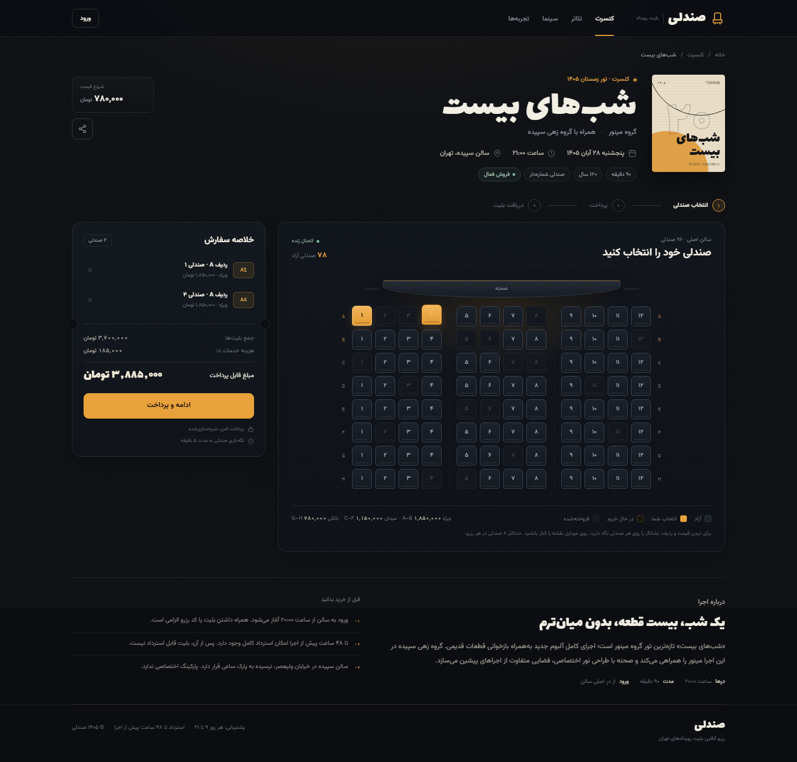

# صندلی

سیستم رزرو آنلاین صندلی برای رویدادها؛ نوشته‌شده با Go و رابط کاربری فارسی راست‌به‌چپ.

این پروژه یک سالن ۹۶ نفره را مدل می‌کند: کاربر صندلی انتخاب می‌کند، صندلی برای مدت محدود نگه داشته می‌شود، پرداخت انجام می‌شود و بلیت الکترونیکی صادر می‌شود. تمام تغییر وضعیت‌ها روی سرور و به‌صورت اتمیک انجام می‌شوند تا یک صندلی هرگز دو بار فروخته نشود.

بک‌اند فقط از کتابخانه استاندارد Go استفاده می‌کند. فایل‌های رابط کاربری با `go:embed` داخل باینری قرار می‌گیرند و فونت‌ها به‌صورت محلی همراه پروژه هستند؛ بنابراین برای اجرا به Node.js، CDN یا سرویس خارجی نیازی نیست.

## نمای صفحه



## امکانات

- نقشه ۹۶ صندلی در ۸ ردیف با سه سطح قیمت
- انتخاب حداکثر ۸ صندلی در هر سفارش
- رزرو موقت ۵ دقیقه‌ای با شمارش معکوس و آزادسازی خودکار
- پرداخت شبیه‌سازی‌شده با اعتبارسنجی شماره کارت، تاریخ انقضا و CVV
- صدور بلیت با کد رزرو، بارکد و امکان چاپ
- به‌روزرسانی زنده وضعیت صندلی‌ها برای همه کاربران با Server-Sent Events
- بازیابی سفارش نیمه‌تمام بعد از بارگذاری مجدد صفحه
- رابط واکنش‌گرا برای دسکتاپ و موبایل

## اجرا

```powershell
cd projects\seaty
go run . -addr 127.0.0.1:8080
```

سپس آدرس زیر را باز کنید:

```text
http://127.0.0.1:8080
```

برای ساخت فایل اجرایی:

```powershell
go build -o seaty.exe .
.\seaty.exe -addr 127.0.0.1:8080
```

برای دسترسی از داخل شبکه:

```powershell
.\seaty.exe -addr :8080
```

### مشخصات پرداخت آزمایشی

```text
شماره کارت: 4242 4242 4242 4242
تاریخ انقضا: 09/29
CVV2: 123
```

در درگاه گزینه‌ای برای شبیه‌سازی پرداخت ناموفق وجود دارد. در این حالت صندلی‌ها آزاد نمی‌شوند و کاربر می‌تواند دوباره تلاش کند.

## معماری

سه بخش اصلی وجود دارد:

1. `Store` وضعیت سالن، رزروهای موقت و بلیت‌ها را نگه می‌دارد. تمام دسترسی‌ها به این وضعیت از یک `sync.Mutex` عبور می‌کنند.
2. لایه HTTP درخواست‌ها را دریافت می‌کند، session را با کوکی HttpOnly می‌شناسد، اعتبار ورودی‌ها را بررسی می‌کند و پاسخ JSON می‌دهد.
3. رابط کاربری با HTML، CSS و JavaScript نوشته شده و بدون build step اجرا می‌شود.

جریان یک خرید:

```text
انتخاب صندلی
    |
POST /api/hold
    |
held  ── ۵ دقیقه ──> آزادسازی خودکار
    |
POST /api/pay
    |
booked + بلیت
```

## چرخه وضعیت صندلی

هر صندلی یکی از سه وضعیت زیر را دارد:

| وضعیت | معنی |
|---|---|
| `available` | قابل انتخاب |
| `held` | موقتاً برای یک session نگه داشته شده |
| `booked` | فروخته شده و غیرقابل تغییر |

قواعد اصلی:

- رزرو موقت پنج دقیقه اعتبار دارد.
- هر session فقط یک رزرو موقت فعال می‌تواند داشته باشد.
- رزرو چندصندلی همه‌یا‌هیچ است؛ اگر یکی از صندلی‌ها آزاد نباشد، هیچ‌کدام رزرو نمی‌شوند.
- هنگام شروع پرداخت، وضعیت رزرو به `Paying` می‌رود و اعتبار آن تمدید می‌شود.
- اگر پرداخت ناموفق باشد، صندلی‌ها همچنان در اختیار کاربر می‌مانند.
- پس از پرداخت موفق، صندلی‌ها `booked` می‌شوند و رزرو موقت حذف می‌شود.
- یک goroutine پس‌زمینه هر دو ثانیه رزروهای منقضی را آزاد می‌کند.

## کنترل همزمانی

مشکل اصلی این سیستم جلوگیری از double-booking است. اگر دو درخواست هم‌زمان ابتدا صندلی را آزاد ببینند و هر دو بخواهند آن را بگیرند، بدون هماهنگی هر دو موفق می‌شوند.

در این پروژه بررسی و تغییر وضعیت داخل یک critical section انجام می‌شود:

```go
s.mu.Lock()
defer s.mu.Unlock()

if seat.Status != SeatAvailable {
    return ErrSeatTaken
}

seat.Status = SeatHeld
seat.HoldID = hold.ID
```

نکته مهم این است که خواندن وضعیت و نوشتن آن از هم جدا نیستند. درخواست دوم پشت قفل منتظر می‌ماند، سپس صندلی را `held` می‌بیند و با خطای تضاد برمی‌گردد.

سه نکته تکمیلی:

- تماس با درگاه پرداخت بیرون از قفل انجام می‌شود تا یک درخواست کند کل سالن را قفل نکند.
- بعد از بازگشت از درگاه، مالکیت تک‌تک صندلی‌ها دوباره زیر قفل بررسی می‌شود.
- پرداخت idempotent است؛ اگر همان `holdId` دوباره ارسال شود، همان بلیت قبلی برگردانده می‌شود و بلیت دوم صادر نمی‌شود.

## API

| متد | مسیر | توضیح |
|---|---|---|
| `GET` | `/api/state` | وضعیت سالن، آمار و رزرو موقت session |
| `POST` | `/api/hold` | رزرو موقت؛ بدنه: `{"seatIds":["A1","A2"]}` |
| `POST` | `/api/release` | آزادسازی رزرو موقت؛ بدنه: `{"holdId":"h_..."}` |
| `POST` | `/api/pay` | پرداخت و صدور بلیت |
| `GET` | `/api/events` | جریان SSE وضعیت زنده |
| `GET` | `/api/health` | سلامت سرویس |

پاسخ خطاها ساختار یکسان دارد:

```json
{
  "ok": false,
  "error": {
    "code": "seat_taken",
    "message": "چند صندلی در همین لحظه توسط کاربر دیگری انتخاب شد.",
    "seats": ["A1"]
  }
}
```

## تست

```powershell
go test ./...
```

تست‌ها این موارد را پوشش می‌دهند:

- رزرو هم‌زمان یک صندلی با ۲۵۰ goroutine و بررسی اینکه فقط یک درخواست موفق می‌شود
- همه‌یا‌هیچ بودن رزرو چندصندلی
- آزادسازی صندلی بعد از انقضای TTL
- پرداخت موفق، ثبت بلیت و idempotent بودن درخواست تکراری
- حفظ صندلی پس از پرداخت ناموفق

روی سیستم‌هایی که cgo دارند می‌توانید `go test -race ./...` را هم اجرا کنید.

## ساختار پروژه

```text
seaty/
├─ main.go
├─ store.go
├─ store_test.go
├─ go.mod
├─ web/
│  ├─ index.html
│  └─ assets/
│     ├─ styles.css
│     ├─ app.js
│     ├─ fonts.css
│     └─ fonts/
├─ fetch-fonts.js
└─ README.md
```

- `main.go`: سرور HTTP، مسیرها، اعتبارسنجی پرداخت، SSE و میان‌افزارها
- `store.go`: مدل داده، قفل، رزرو موقت، پرداخت و آزادسازی
- `store_test.go`: تست‌های همزمانی و چرخه رزرو
- `web/`: رابط کاربری و فونت‌های محلی
- `fetch-fonts.js`: ابزار اختیاری برای بازسازی فایل‌های فونت

## اجرا روی چند سرور

`sync.Mutex` فقط داخل یک پروسه کار می‌کند. اگر سیستم روی چند instance اجرا می‌شود، همان critical section باید به لایه داده منتقل شود. یک الگوی مناسب در PostgreSQL:

```sql
BEGIN;

SELECT id
FROM seats
WHERE id = ANY($1)
FOR UPDATE;

UPDATE seats
SET status = 'held',
    hold_id = $2,
    hold_until = now() + interval '5 minutes'
WHERE id = ANY($1);

COMMIT;
```

اگر هر صندلی در وضعیت `available` نبود، تراکنش باید برگردد. برای Redis هم می‌توان همین منطق را با یک اسکریپت Lua اتمیک پیاده کرد.

## نکات محیط واقعی

- داده‌ها در حافظه نگه داشته می‌شوند و با ری‌استارت پاک می‌شوند. برای محیط واقعی از PostgreSQL یا MySQL استفاده کنید.
- پرداخت شبیه‌سازی‌شده است و هیچ اطلاعات کارتی ذخیره یا ارسال نمی‌شود.
- احراز هویت واقعی وجود ندارد؛ session با یک کوکی HttpOnly و SameSite مدیریت می‌شود.
- برای محیط production باید rate limit، لاگ ساخت‌یافته، مانیتورینگ و درگاه پرداخت واقعی اضافه شود.
- نام گروه و جزئیات رویداد خیالی است و به رویداد واقعی اشاره نمی‌کند.
